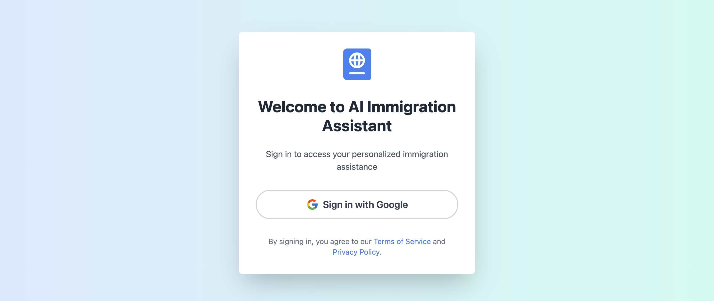
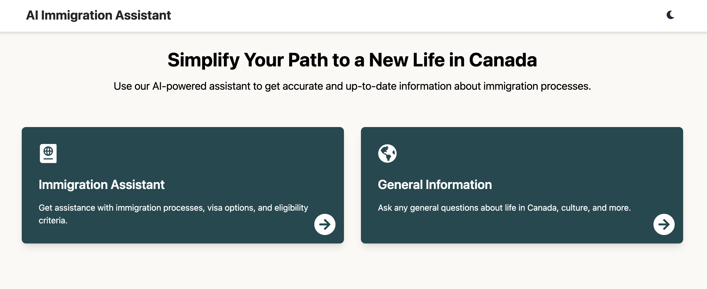
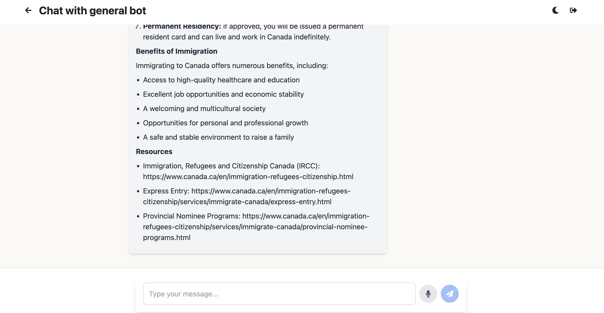
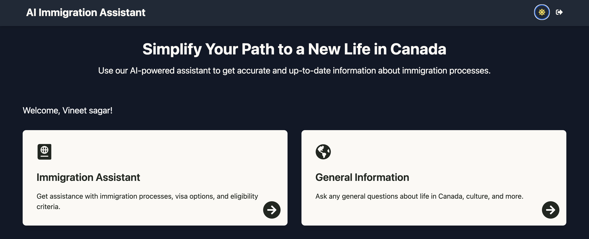

# AI Immigration Assistant

An intelligent chatbot designed to simplify the Canadian immigration process by providing accurate and up-to-date information.

**Who it's for:** people planning to move to Canada (students, workers, families) who want quick, plain-language answers about visa types, application steps and life in Canada before they read the official guides or talk to a licensed consultant.

| Login Page | Landing Page |
|------------|--------------|
|  |  |

| Chat Page | Theming |
|-----------|---------|
|  |  |

## Login Page
The login page provides secure access to the AI Immigration Assistant.

## Landing Page
The landing page introduces users to the main features of the application.

## Chat Page
The chat interface allows users to interact with the AI assistant for immigration-related queries.

## Theming
The application supports customizable themes for a personalized user experience.

[Live Demo](https://ai-immigration-assistant-zeta.vercel.app/)

## Key Features

- Interactive AI-powered chatbot for Canadian immigration queries
- Accurate and up-to-date information on immigration processes
- User authentication for personalized experiences
- Chat history persistence using local storage
- Dark mode and customizable themes
- Responsive design for desktop and mobile devices
- Powered by Google Gemini AI API for intelligent responses
- General information about life in Canada
- Accessibility features

- Multilingual support (Not implemented yet)

**Important Note:** This chatbot is designed for informational purposes only and should not replace professional immigration advice.

## Technologies Used

- Next.js 14
- React
- TypeScript
- Tailwind CSS
- Google Gemini AI API
- NextAuth (Google sign-in)
- Jest + React Testing Library

## Getting Started

1. Clone the repository:
   ```bash
   git clone https://github.com/vineetsgr07/AI-Immigration-Assistant.git
   cd AI-Immigration-Assistant
   ```

2. Install dependencies:
   ```bash
   npm install
   ```

3. Copy the example env file and fill in your own keys:
   ```bash
   cp .env.example .env.local
   ```
   You need a Gemini API key (`GOOGLE_API_KEY`), a Google OAuth client (`GOOGLE_CLIENT_ID`, `GOOGLE_CLIENT_SECRET`) and a `NEXTAUTH_SECRET`.

4. Start the development server:
   ```bash
   npm run dev
   ```

5. Open your browser and navigate to `http://localhost:3000` to access the chat interface.

## Testing

To run the tests, use the following command:
```bash
npm test
```

## Deployment

The application is deployed on Vercel.

## Data and privacy

- No database. Sign-in uses a Google account through NextAuth; the session lives in a signed cookie.
- Chat history is saved only in the user's own browser (`localStorage`) and can be cleared there.
- Each question is sent to the Google Gemini API to generate the answer.

## Roadmap

Planned work, roughly in order:

- [ ] Move from the retired `gemini-pro` model and `@google/generative-ai` to a current Gemini model and the `@google/genai` SDK.
- [ ] Stream answers token by token instead of waiting for the full reply.
- [ ] Ground answers in official IRCC pages and show the source links under each answer.
- [ ] Replace the keyword topic filter in `api/chat` with a proper topic check and a clear "out of scope" reply.
- [ ] Add a CRS (Express Entry) score estimator as a guided chat flow.
- [ ] French and other languages (multilingual support).
- [ ] Clear and export chat history from the UI.
- [ ] Rate limiting on `/api/chat`.
- [ ] Upgrade to the current Next.js and Auth.js versions.
- [ ] Tests for the chat API route, `ChatContext` and voice input; accessibility pass on the chat screen.

## Contributing

We welcome contributions to the project. Please read our [contributing guidelines](CONTRIBUTING.md) for more details.

## License

This project is licensed under the MIT License. See the `LICENSE` file for more details.

## Considerations
 - Google Gemini AI API is used as it's currently free, replacing the previous OpenAI API due to changes in their pricing model.
